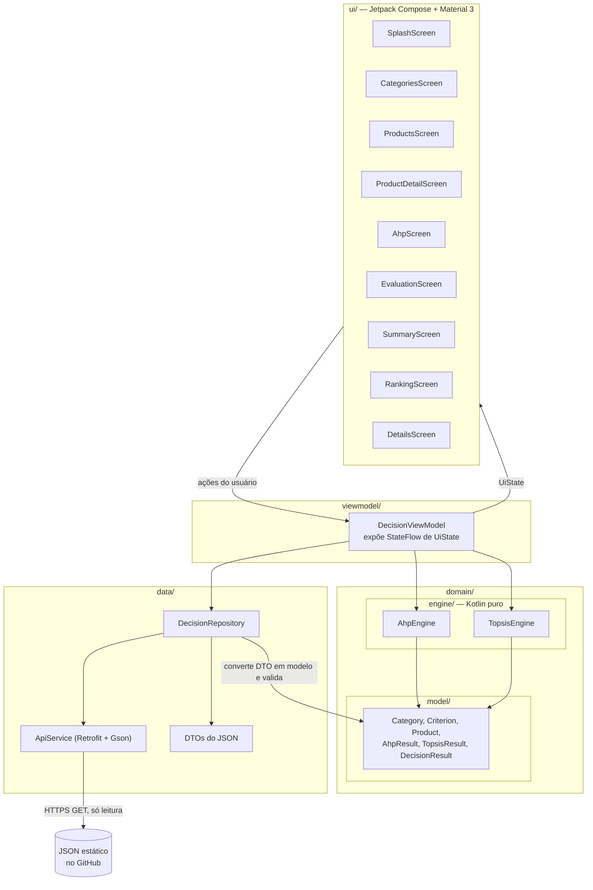
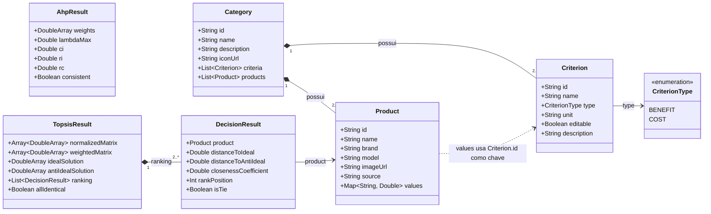
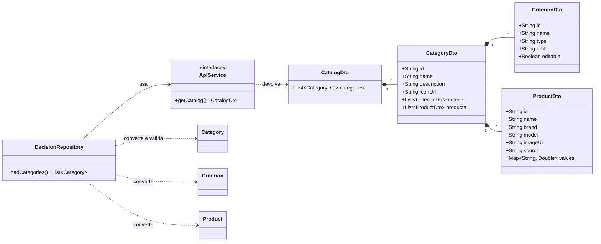
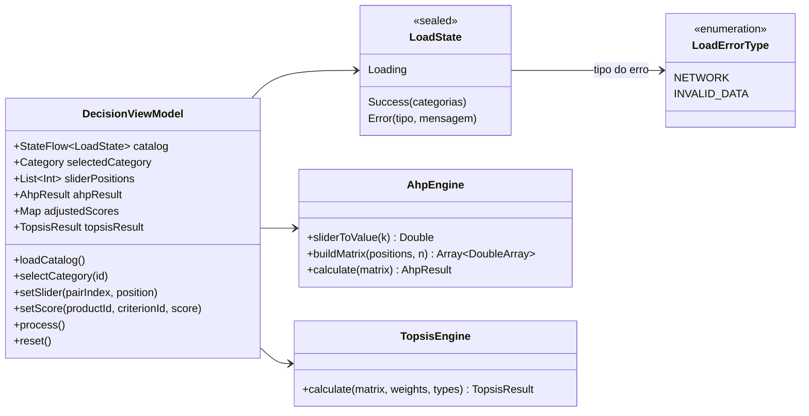
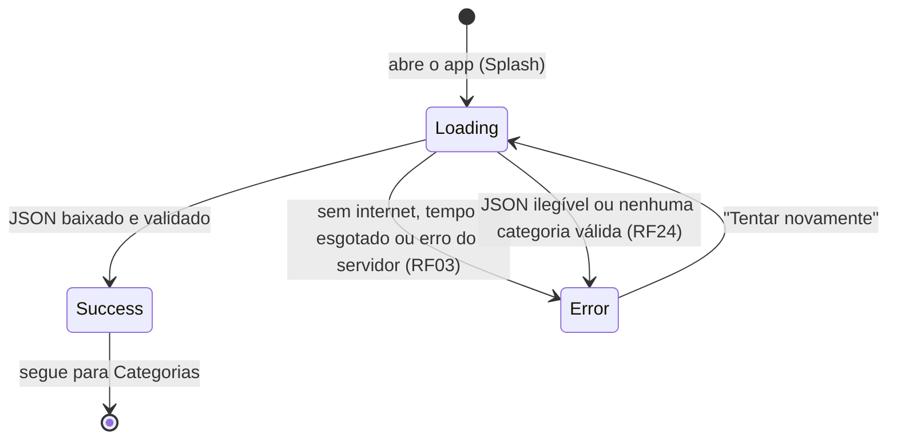
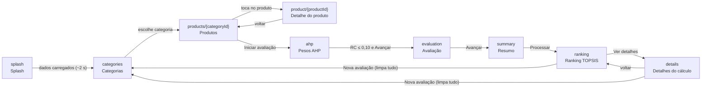
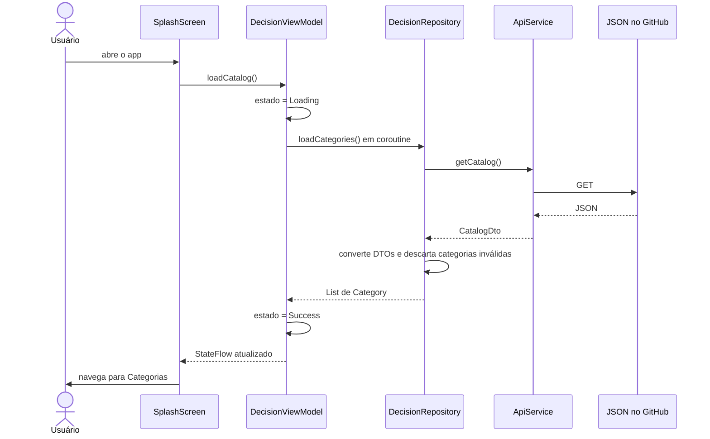
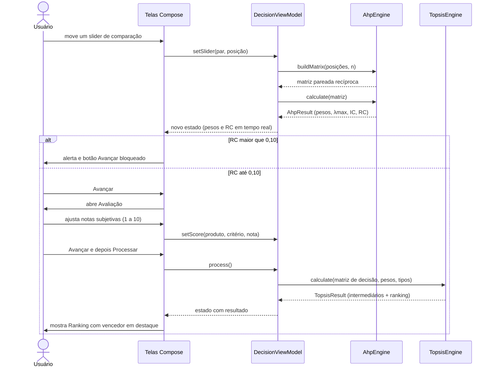

# Modelagem — App de avaliação comparativa de produtos (AHP-TOPSIS)

Fase 1 — Requisitos + Modelagem · PDM 2026/2 · UFU

Este documento reúne os diagramas de **arquitetura (MVVM)**, **modelo de dados** e **navegação**, mais os diagramas de sequência dos dois fluxos principais.

---

## 1. Visão geral da arquitetura (MVVM em 4 camadas)

**Regras de dependência**

- A `ui` só enxerga o `DecisionViewModel`. Ela desenha o estado e envia ações.
- O `DecisionViewModel` é o único que fala com o `Repository` e com os motores.
- Os motores (`AhpEngine`, `TopsisEngine`) são Kotlin puro, sem import do Android, e por isso testáveis com JUnit simples.
- O `Repository` é criado direto pelo ViewModel (`DecisionRepository(api)`), sem injeção de dependência.
- Chamadas de rede rodam em `viewModelScope.launch`, nunca na thread principal.
- Um único `DecisionViewModel` é compartilhado por todas as telas do fluxo, criado no escopo do `NavHost`/Activity, para os dados não se perderem ao navegar.

### Responsabilidade de cada camada

| Camada | Pacote | Responsabilidade | Não deve |
| --- | --- | --- | --- |
| Apresentação | `ui/` | Desenhar telas e enviar eventos | Calcular nada, acessar rede |
| Estado | `viewmodel/` | Guardar estado da avaliação, orquestrar Repository e motores | Importar componentes de tela |
| Domínio | `domain/engine/` e `domain/model/` | Cálculo AHP e TOPSIS; data classes | Importar `android.*` |
| Dados | `data/` | Buscar o JSON, converter DTO em modelo, validar (RN05, RN06, RN08) | Conter regra de cálculo |

---

## 2. Modelo de dados

### 2.1 Domínio

O modelo é **genérico**: um `Product` guarda um mapa `criterionId → valor`. Não existe um campo por critério, então trocar ou adicionar critérios no JSON não exige mudar código.

> `isTie` (RF23) marca produtos empatados (CC igual com 4 casas) e `allIdentical` marca o caso em que todos os produtos são idênticos, para o app avisar que não há como diferenciá-los. Se o empate for em 1º lugar, todos os empatados recebem o destaque de vencedor.
>
> `TopsisResult` é a proposta para devolver os valores intermediários (matriz normalizada, ponderada, A+ e A−) que a tela de **Detalhes do cálculo** precisa mostrar. Ele agrupa a lista de `DecisionResult` do ranking.

**Glossário usado no modelo**

- **Peso:** importância do critério para o usuário (sliders do AHP).
- **Característica:** dado objetivo e fixo do produto (preço, kg, bateria...), vindo do JSON.
- **Nota subjetiva:** nota de 1 a 10 de critérios com `editable = true`. O JSON traz a nota de referência e o usuário pode ajustar apenas para a avaliação atual, sem salvar.

### 2.2 Camada de dados (DTOs e conversão)

**Validação no Repository (RN05, RN06, RN08):** ao converter cada `CategoryDto`, a categoria é descartada (não aparece no app) se tiver menos de 2 produtos, menos de 2 ou mais de 10 critérios, ou qualquer valor menor ou igual a zero. Notas subjetivas também precisam ser inteiros de 1 a 10. O `type` do JSON (`"BENEFIT"` ou `"COST"`) é convertido para o enum `CriterionType`.

### 2.3 Estado do ViewModel

- `sliderPositions` guarda uma posição inteira de −8 a +8 por par de critérios (n(n−1)/2 posições). Todos começam em 0 (critérios iguais).
- `adjustedScores` guarda só os ajustes do usuário nos critérios `editable`. Valores não ajustados usam a nota de referência do JSON.
- O erro tem dois tipos, porque as mensagens são diferentes: `NETWORK` (RF03: "Não foi possível carregar os dados. Verifique sua conexão com a internet.") e `INVALID_DATA` (RF24: "Os dados dos produtos estão com problema. Tente novamente mais tarde."). Ambos mostram "Tentar novamente".
- `selectCategory(id)` começa uma avaliação do zero (RF18): sliders em 0 e notas ajustadas descartadas.
- Voltar para telas anteriores não limpa nada (RF19, RNF07), porque o estado fica no ViewModel compartilhado. Só `reset()` e `selectCategory(id)` limpam.
- `reset()` limpa tudo (usado por "Nova avaliação").

### 2.4 Estados de carregamento

---

## 3. Navegação

| Rota | Tela | Principais dados lidos do ViewModel | Ação principal |
| --- | --- | --- | --- |
| `splash` | Splash | `LoadState` | Dispara `loadCatalog()`; erro mostra "Tentar novamente" |
| `categories` | Categorias | Lista de `Category` | `selectCategory(id)`; também mostra o erro com "Tentar novamente" se o carregamento falhar (RF03, RF24) |
| `products/{categoryId}` | Produtos | `Category.products` | Abrir detalhe ou "Iniciar avaliação" |
| `product/{productId}` | Detalhe do produto | `Product` + `Criterion` | Somente leitura |
| `ahp` | Pesos AHP | `sliderPositions`, `AhpResult` | `setSlider(...)`; botão bloqueado se RC > 0,10 (RN02) |
| `evaluation` | Avaliação | Matriz de valores, critérios `editable` | `setScore(...)` (1 a 10) |
| `summary` | Resumo | Pesos + matriz de decisão | `process()` |
| `ranking` | Ranking | `TopsisResult.ranking` | "Nova avaliação" |
| `details` | Detalhes do cálculo | Matriz normalizada ponderada, A+, A−, CC | Voltar ou "Nova avaliação" |

---

## 4. Diagramas de sequência

### 4.1 Carregamento dos dados

### 4.2 Pesos (AHP) até o ranking (TOPSIS)

---

## 5. Contrato dos motores

| Motor | Entrada | Saída |
| --- | --- | --- |
| `AhpEngine.sliderToValue(k)` | posição inteira de −8 a +8 | `1` se k = 0; `k+1` se k > 0; `1/(|k|+1)` se k < 0 |
| `AhpEngine.buildMatrix(posições, n)` | posições dos n(n−1)/2 sliders | matriz n×n recíproca com diagonal 1 (RN01) |
| `AhpEngine.calculate(matriz)` | matriz pareada | `AhpResult`: pesos (média geométrica normalizada, somam 1), λmax, IC, IR, RC, `consistent` |
| `TopsisEngine.calculate(matriz, pesos, tipos)` | matriz de decisão m×n, pesos, `BENEFIT`/`COST` por coluna | `TopsisResult`: normalizada, ponderada, A+, A−, d+, d−, CC, posição |

**Casos de borda tratados no TOPSIS (RN07):** coluna com norma zero gera `r = 0`; se d+ + d− = 0 (produtos idênticos), CC = 0 para todos e o app mostra empate; CC igual com 4 casas decimais gera empate com a mesma posição (ex.: 1º, 2º, 2º, 4º).

---

## 6. Decisões de modelagem

| Decisão                                   | Motivo                                                                          |
| ----------------------------------------- | ------------------------------------------------------------------------------- |
| Modelo genérico com `Map<String, Double>` | Critérios e produtos vêm do JSON; o código não depende de critérios específicos |
| Motores em Kotlin puro                    | Testáveis sem emulador                                                          |
| Um único ViewModel compartilhado          | Evita perder pesos e notas ao navegar entre telas                               |
| Estados `Loading`, `Success`, `Error`     | Splash e telas reagem a carregamento e falha de rede de forma uniforme          |
| Ajustes de nota não persistidos           | Valem só para a avaliação atual; "Nova avaliação" limpa tudo                    |
